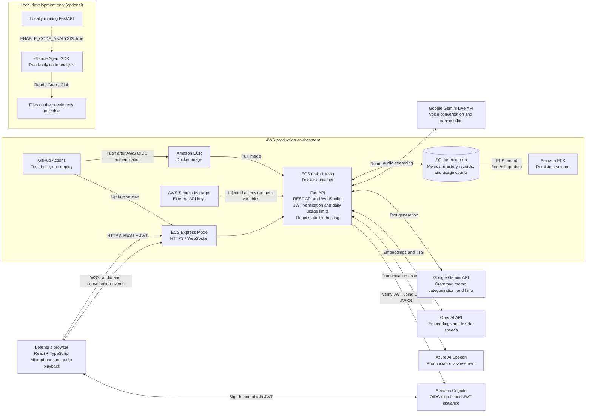

# Mingo System Architecture

## Overview

## Main request flows

1. The browser signs in with Cognito and obtains a JWT. FastAPI verifies the token in the `Authorization` header for REST API requests and in the connection query string for the conversation WebSocket.
2. The React app is served from the same ECS Express Mode URL. API requests use HTTPS, while voice conversations connect to FastAPI over WebSocket.
3. FastAPI relays conversation audio to the Gemini Live API and calls the AI APIs for tasks such as grammar checks and hint generation. Azure AI Speech is used for pronunciation assessment.
4. Memos, learning progress, and API usage counts are stored in SQLite. In production, the SQLite file resides on EFS and the service is limited to one task.
5. GitHub Actions runs the backend tests, builds and pushes a Docker image to ECR, and updates the ECS Express Mode service.

## Notes

- The ECS task mounts EFS at `/mnt/mingo-data` and sets `MEMO_DB_PATH=/mnt/mingo-data/memo.db`.
- External API keys are managed in Secrets Manager and passed to the application as task environment variables.
- Code analysis is an optional local-development feature. When `ENABLE_CODE_ANALYSIS=true`, the Claude Agent SDK reads project files on the developer's machine. It is not part of the normal production request flow.
