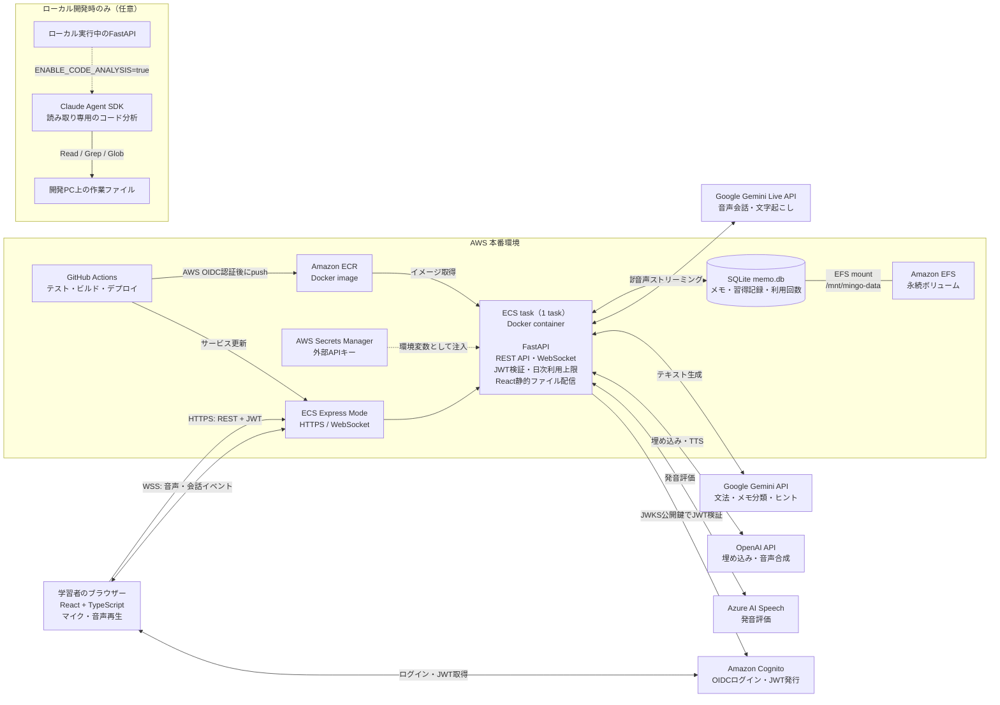

# Mingo システムアーキテクチャ

[English version](architecture.en.md)

## 全体構成

## 主なリクエストの流れ

1. ブラウザーがCognitoでログインし、JWTを取得します。REST APIではAuthorizationヘッダー、会話WebSocketでは接続時のトークンをFastAPIが検証します。
2. React画面は同じECS Express ModeのURLから配信されます。通常のAPI呼び出しはHTTPS、音声会話はWebSocketでFastAPIに接続します。
3. FastAPIは会話音声をGemini Live APIへ中継し、会話中の文法チェックやヒント生成などを各AI APIに依頼します。発音評価ではAzure AI Speechを使用します。
4. メモ、習得状況、API利用回数はSQLiteに保存します。本番ではSQLiteファイルをEFS上に置き、タスク数を1に制限します。
5. GitHub Actionsはバックエンドテストの後、DockerイメージをECRにpushし、ECS Express Modeのサービスを更新します。

## 補足

- ECSタスク定義からEFSを`/mnt/mingo-data`にマウントし、`MEMO_DB_PATH=/mnt/mingo-data/memo.db`を指定します。
- 外部APIキーはSecrets Managerで管理し、タスクの環境変数としてアプリに渡します。
- コード分析機能はローカル開発時のみの任意機能です。`ENABLE_CODE_ANALYSIS=true`の場合にClaude Agent SDKが開発PC上の作業ファイルを読み取ります。本番の通常経路には含まれません。
